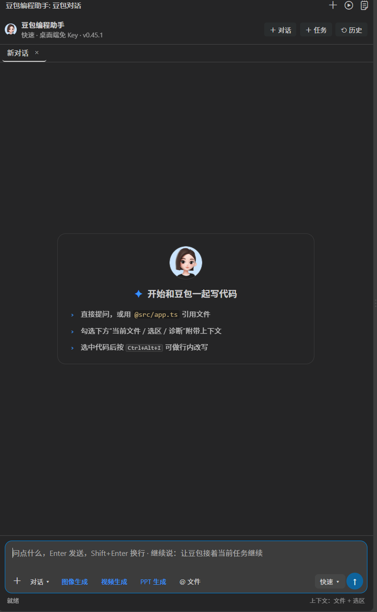
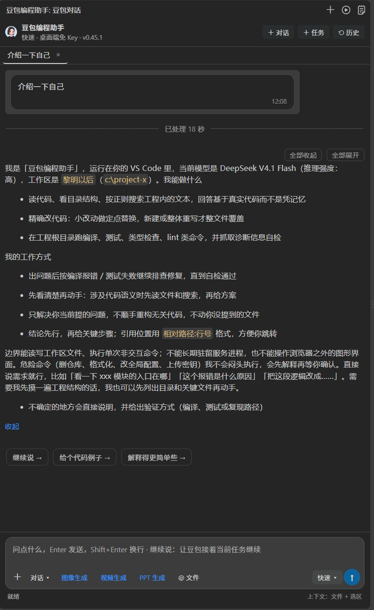

# 豆包编程助手（doubao-coder）

> 第三方 VS Code 扩展，形态对标腾讯云 CodeBuddy：**侧边栏 AI 对话 + Agent 工具调用 + 行内补全 + 行内改写（Ctrl+Alt+I）+ 把选区投送到豆包桌面客户端 + 附带 MCP stdio server**。
>
> 模型侧通过**火山方舟 Ark 的 OpenAI 兼容接口**访问豆包（默认模型 `doubao-seed-code`，可配置）。
> 本项目与字节跳动 / 豆包官方无关，属于个人第三方实现；API Key 与调用费用由使用者自行承担。

**开发者：艾米尔**

## 界面预览

### 新对话与任务标签页



> 顶部是任务标签栏（历史任务、新建对话/任务都会自动成为标签，可切换/关闭）；
> 输入框上方是 `＋`、`对话`、`图像生成 / 视频生成 / PPT 生成`（互斥单选）、`@ 文件` 快捷入口。

### 对话输出与执行状态



> 回复支持代码块/表格分类折叠与「全部收起 / 全部展开」；执行过程按步分组、可展开查看，
> 底部提供「继续说 / 给个代码例子 / 解释得更简单」快捷追问。

---

## 1. 功能

| 功能 | 说明 |
| --- | --- |
| **本机豆包 CLI（轻量，推荐）** | 调用已登录的官方 `doubao -p`：文件读写、终端、技能、子 Agent、权限策略全由 CLI 执行，扩展只做侧边栏界面；安装后首次激活三选一（CLI / 桌面版 / Ark），可随时切换。需要 Node 18+ 与豆包团队/企业订阅 |
| **设置中心** | 命令「豆包: 设置中心」或侧边栏标题齿轮：集中切换连接方式、检查登录/连接、修改 CLI/桌面/Ark 与通用配置；所有改动即时生效。未安装 CLI 时给安装卡片，支持**一键自动安装**（实时日志、可取消），装完自动引导登录 |
| **桌面端免 Key 模式** | 直接驱动你**已登录**的豆包桌面端：扩展通过 CDP（`--remote-debugging-port=9222`）把问题写进输入框、点发送、流式读回回复并还原 Markdown。登录态/签名/风控全部由官方客户端完成，**不需要 API Key** |
| **PTC 工具调用（默认开）** | 桌面端通道只有纯文本，所以用 **PTC（Programmatic Tool Calling）**：模型输出 ` ```tool ` 代码块 → 扩展解析执行 8 个内置工具（外加任意 MCP 工具）→ 把 `<tool_result>` 发回同一会话。免 Key 也能读写工作区 |
| 侧边栏对话 | 活动栏「豆包编程助手」图标 → 「豆包对话」Webview，流式输出、Markdown 渲染、代码块「复制 / 插入」按钮 |
| Agent 工具调用 | 模型可调用 8 个内置工具：`read_file` `list_dir` `grep` `write_file` `apply_patch` `run_terminal` `run_checks` `get_diagnostics`，多轮自主执行（最多 `doubao.maxToolIterations` 轮） |
| @ 上下文 | 勾选「当前文件 / 选区 / 诊断」自动附带；输入 `@src/app.ts` 直接引用工作区文件内容 |
| 项目规则 | 自动读取 `.doubao/rules.md`（路径可配置），追加进系统提示词 |
| 行内补全 | 基于 FIM（`/completions`，失败回退 chat），300ms 防抖 + 2s 结果缓存 |
| 行内改写 | 选中代码 → `Ctrl+Alt+I` → 输入改写要求 → diff 预览 → 应用（走 `WorkspaceEdit`，可撤销）。**桌面端模式免 Key**，Ark 模式走流式 |
| 历史对话管理 | 顶部「⟲ 历史」打开管理面板：搜索、本地/豆包分组、批量选择删除、单条重命名、导出 Markdown、删除；豆包对话可直接打开，管理仍在豆包客户端 |
| 撤销改动 | 命令「查看/撤销上一次改动」用 `vscode.diff` 对比旧内容与当前内容，可一键回退 |
| 投送豆包客户端 | 命令把选区/文件通过 `doubao://doubaoapp/active-chat?...` deep link 唤起豆包桌面客户端，并同时复制到剪贴板 |
| MCP stdio server | 独立脚本 `out/mcp/server.js`，JSON-RPC 2.0（initialize / tools/list / tools/call），文件与 shell 访问被限制在指定根目录内 |
| **外部 MCP 工具聚合（客户端）** | 在 `doubao.mcp.servers` 里配置任意 stdio MCP server，扩展会启动它们，把工具以 `mcp__<server>__<tool>` 暴露给 Agent（Ark / PTC / 任务模式共用）。单个 server 失败不影响其他，改配置自动重连 |
| **一键工程自检** | 命令「豆包: 运行工程检查」或 Agent 工具 `run_checks`：自动识别 package.json 的 typecheck/compile/lint/test，跑完把错误诊断与输出尾部回灌给模型 |
| **本地电脑模式（对齐豆包桌面端）** | 输入框上方是单行胶囊工具栏：`＋ / 本地电脑 / 项目 / 按需确认 / 技能 / 插件 / 模型 / ⋯ / ↑`。模式、确认策略、模型、推理强度、上下文都用豆包式弹出菜单选择，不再堆两行按钮和复选框。本地电脑模式下发送任务会走「计划 → 单步动作 → 按权限确认 → 执行 → 回灌」 |
| **桌面端模型 / 推理强度对齐** | 模型菜单直接读桌面端真实列表（含 `DeepSeek V4.1 Flash`），选中后写回桌面端；推理强度支持低/中/高/极高。每次本地电脑任务发送前自动对齐 `doubao.desktop.model` 与 `doubao.desktop.reasoning` |
| **技能 / 插件同步豆包** | 扩展启动时预读取一次并缓存，失败自动重试并在状态栏提示。新建对话 / 新任务不再刷新，点击「技能」「插件」或输入 `/` 直接使用缓存列表；技能按 `常用 / 快捷功能 / 技能` 分组，插件显示已安装项（如「地图」）。菜单支持搜索，选择后以 `@名称` 插入输入框。添加/管理/技能管理等入口不在扩展里提供，用户直接去豆包客户端管理 |
| **生成图片 / 附件回显** | 桌面端回复里的 `message_image_content` 会解析成缩略图 + 原图链接，直接显示在 VS Code 侧边栏；点击图片或「打开原图」用系统浏览器打开签名 URL。PTC / 任务模式同样生效 |
| 状态栏 | 显示模型与 Key 配置状态，点击打开对话面板 |

## 2. 目录结构

```
doubao-coder/
├─ package.json                 # 扩展清单（视图/命令/配置/快捷键/菜单）
├─ tsconfig.json                # ES2022 + commonjs + strict，src → out
├─ .vscodeignore                # 打包排除项
├─ .vscode/launch.json          # F5 调试配置
├─ .vscode/tasks.json           # npm: compile 任务
├─ media/
│  ├─ chat.css                  # 侧边栏样式（全部走 VS Code 主题变量）
│  ├─ chat.js                   # 原生 JS 前端：流式渲染 / 极简 Markdown / 代码块按钮
│  ├─ settings.css              # 设置中心样式
│  ├─ settings.js               # 设置中心前端：连接方式 / 登录 / 常用配置
│  ├─ doubao-icon.png           # 扩展图标（128×128，取自豆包桌面端 icon.ico）
│  └─ doubao-activity.png       # 活动栏图标（48×48，同一来源）
└─ src/
   ├─ extension.ts              # activate/deactivate，注册命令、视图、补全、状态栏
   ├─ config.ts                 # doubao.* 配置 + ARK_API_KEY 等环境变量兜底 + 校验
   ├─ log.ts                    # OutputChannel「豆包编程助手」
   ├─ ark/client.ts             # ArkClient：chatStream(SSE + tool_calls 增量) / completeFIM / abort
   ├─ agent/
   │  ├─ tools.ts               # 工具 JSON Schema + 执行器（含路径限制、WorkspaceEdit、终端确认、外部工具路由）
   │  ├─ checks.ts              # 工程自检：检测/执行 compile·lint·test，解析 TS/ESLint 诊断
   │  └─ loop.ts                # Agent 多轮循环、AbortSignal、事件回调、历史裁剪
   ├─ chat/
   │  ├─ panel.ts               # WebviewViewProvider + 消息协议 + CSP(nonce)
   │  └─ prompt.ts              # 系统提示词、@上下文拼装、规则文件、行内改写提示词
   ├─ completion/provider.ts    # InlineCompletionItemProvider（防抖/取消/缓存/上下文裁剪）
   ├─ cli/runner.ts             # 豆包 CLI 调用：参数拼装 / 输出清理 / 超时中断 / 会话 ID
   ├─ cli/detect.ts             # CLI 探测：可执行文件 / 版本 / 登录态
   ├─ settings/panel.ts         # 设置中心 Webview（连接 / 登录 / 常用配置）
   ├─ settings/schema.ts        # 设置白名单 + 枚举/范围校验
   ├─ inline/edit.ts            # 行内改写：选区→指令→Ark→diff 预览→应用；撤销
   ├─ doubao/bridge.ts          # deep link 构造与 openExternal
   ├─ mcp/server.ts             # 独立 MCP stdio server（不依赖 vscode 模块）
   ├─ mcp/client.ts             # MCP stdio 客户端 + 多 server 连接池（零第三方依赖）
   └─ mcp/manager.ts            # MCP 生命周期 + ToolDefinition 适配（接进 Agent）
```

## 3. 环境要求

- Node.js ≥ 20（本机验证：Node v24）
- VS Code ≥ 1.90.0
- **桌面端模式**：本机安装豆包桌面端（默认路径 `%LOCALAPPDATA%\Doubao\Application\app\Doubao.exe`），
  并能接受"以调试端口启动"（会抢焦点、回复会写进你的豆包会话）
- **CLI 模式**：Node.js 18+，已安装并登录豆包 CLI（团队/企业订阅），见 [豆包 CLI 文档](https://www.doubao.com/work/docs/zh-cn/doubao-cli)
- **Ark 模式**：一个可用的火山方舟 Ark API Key

## 4. 构建

```powershell
cd D:\rex86\doubao-re\extension\doubao-coder
npm install --no-audit --no-fund          # 安装 typescript / @types/vscode / @types/node
npm run compile                            # 等价于 tsc -p .
npm test                                   # 284 项离线单测（策略/PTC/工具/检查/MCP/UI 协议/路径边界/竞态等）
npm run package                            # npx @vscode/vsce package → dist/*.vsix
```

> 没有打包器（esbuild/webpack）：`tsc` 直接把 `src/**/*.ts` 编译到 `out/**/*.js`，扩展入口为 `out/extension.js`。

## 5. 运行 / 调试（F5）

1. 用 VS Code 打开 `doubao-coder` 目录（作为工作区文件夹）。
2. `Ctrl+Shift+B` 或 `npm run compile` 先编译一次。
3. 按 **F5**（或运行面板选「运行豆包编程助手（扩展开发宿主）」）启动 Extension Development Host。
4. 首次使用（**默认桌面端模式，不需要 Key**）：
   - 命令面板 → **豆包: 以调试端口启动桌面端**（或点启动提示里的「一键启动」）
   - 扩展会自动查找豆包安装路径；如果豆包已经在运行，会询问是否重启（**登录状态保留**）
   - 侧边栏直接对话即可
   - **换到另一台电脑**：登录态属于那台电脑的豆包客户端，不会随 VSIX 复制过去。先在那台电脑登录豆包，再用上面的命令连接；安装路径特殊时设置 `doubao.desktop.exePath`
5. 想改用官方 Ark API：设置 `doubao.authMode` 为 `ark`，再执行 **豆包: 设置 API Key**（或设 `ARK_API_KEY`）。
6. 点击活动栏「豆包编程助手」图标开始对话。

也可以直接打包成本地 vsix（需要 `@vscode/vsce`，未随依赖安装）：

```powershell
npx --yes @vscode/vsce package
```

## 6. 配置项

| 配置 | 默认值 | 说明 |
| --- | --- | --- |
| `doubao.authMode` | `desktop` | `cli`=本机豆包 CLI（轻量，Agent 由 CLI 执行）；`desktop`=驱动已登录的桌面端（免 Key）；`ark`=官方 API（需 Key） |
| `doubao.cli.path` | 自动 | CLI 可执行文件；留空探测 `%LOCALAPPDATA%\doubao_cli\app\current\doubao.exe` 与 PATH |
| `doubao.cli.permissionMode` | `ask_risky` | 传给 `--permission-mode`：`ask_always` / `ask_risky` / `always_allow` |
| `doubao.cli.model` | 空 | 传给 `--model`；空=Auto |
| `doubao.cli.effort` | 空 | `Low` / `Medium` / `High`；空=不传 |
| `doubao.cli.timeoutMs` | `600000` | 单次 CLI 任务超时（毫秒） |
| `doubao.desktop.port` | `9222` | 桌面端 CDP 调试端口 |
| `doubao.desktop.exePath` | 自动 | 豆包可执行文件路径（留空按 `%LOCALAPPDATA%` 推导） |
| `doubao.desktop.newChat` | `false` | 每次提问前是否在豆包里新开对话 |
| `doubao.desktop.timeoutMs` | `180000` | 等待回复上限 |
| `doubao.ptc.enabled` | `true` | 桌面端通道下启用 PTC 文本工具调用（关闭则纯对话） |
| `doubao.ptc.maxRounds` | `8` | PTC 最大工具轮数（每轮会在豆包会话里多一条消息） |
| `doubao.baseUrl` | `https://ark.cn-beijing.volces.com/api/v3` | Ark 地址；Coding Plan 用 `.../api/coding/v3` |
| `doubao.apiKey` | 空 | 优先级最低的明文入口；推荐用命令「豆包: 设置 API Key」写入 SecretStorage |
| `doubao.model` | `doubao-seed-code` | 对话 / Agent 模型 |
| `doubao.completionModel` | `doubao-seed-code` | 行内补全模型，留空复用 `doubao.model` |
| `doubao.temperature` | `0.2` | 采样温度（0–2） |
| `doubao.maxTokens` | `4096` | 单次回复最大 token |
| `doubao.maxToolIterations` | `16` | Agent 单轮最多工具循环次数（1–80） |
| `doubao.enableInlineCompletion` | `true` | 行内补全开关 |
| `doubao.systemPromptFile` | 空 | 自定义系统提示词文件（绝对路径或工作区相对路径） |
| `doubao.rulesFile` | `.doubao/rules.md` | 项目规则文件 |
| `doubao.terminal.autoRun` | `true` | 默认直接执行终端命令，不再逐条确认；设为 `false` 恢复每条命令模态确认 |
| `doubao.mcp.enabled` | `false` | 仅用于激活时打印内置 MCP server 路径（内置 server 需要外部 MCP 客户端挂载） |
| `doubao.mcp.servers` | `[]` | 外部 MCP server 列表（stdio）。每项：`{ name, command, args, env, cwd, enabled, timeoutMs }`；工具以 `mcp__<server>__<tool>` 暴露，改配置自动重连 |
| `doubao.chat.mode` | `local` | 侧边栏默认模式：`chat` 普通对话；`local` 本地电脑（任务模式）。对应输入框上方的「对话 / 本地电脑」开关 |
| `doubao.desktop.workMode` | `local` | 发送前把桌面端切到哪个工作模式：`local` 工作任务·本地电脑；`chat` 对话；`auto` 跟随扩展模式 |
| `doubao.desktop.model` | `DeepSeek V4.1 Flash` | 本地电脑模式下要对齐的桌面端模型；留空表示不改。模型列表直接来自桌面端菜单 |
| `doubao.desktop.reasoning` | `高` | 本地电脑模式下要对齐的推理强度：低/中/高/极高；留空表示不改 |

环境变量兜底：`ARK_API_KEY`、`DOUBAO_API_KEY`、`ARK_BASE_URL`、`DOUBAO_BASE_URL`、`ARK_MODEL`、`DOUBAO_MODEL`。

## 7. 命令与快捷键

| 命令 | 标题 | 快捷键 |
| --- | --- | --- |
| `doubao.newChat` | 新建对话 | |
| `doubao.explainSelection` | 解释选中代码 | 编辑器右键菜单 |
| `doubao.editSelection` | 行内改写选中代码 | `Ctrl+Alt+I`（macOS `Cmd+Alt+I`） |
| `doubao.applyLastDiff` | 查看/撤销上一次改动 | |
| `doubao.undoLastEdit` | 撤销上一次改动 | |
| `doubao.sendSelectionToDoubaoApp` | 把选区投送到豆包桌面客户端 | 编辑器右键菜单 |
| `doubao.connectDesktop` | 连接豆包桌面端（探测登录态/页面/输入框） | |
| `doubao.launchDesktop` | 以调试端口启动桌面端 | |
| `doubao.setApiKey` | 设置 API Key（写入 SecretStorage） | |
| `doubao.clearApiKey` | 清除 API Key | |
| `doubao.openSettings` | 打开设置 | |
| `doubao.showLogs` | 显示日志 | |
| `doubao.indexWorkspace` | 统计工作区文件数 | |
| `doubao.runChecks` | 运行工程检查（编译 / lint / 测试） | |
| `doubao.mcpStatus` | 查看 MCP 连接状态 | |
| `doubao.selectConnectionMode` | 选择连接方式（CLI / 桌面版 / API Key） | |
| `doubao.cliLogin` | 登录豆包 CLI | |
| `doubao.cliCheck` | 检查 CLI 安装与登录 | |
| `doubao.cliInstall` | 查看 CLI 安装方式 | |
| `doubao.cliAutoInstall` | 自动安装 CLI（打开设置中心并开始 npm 安装） | |
| `doubao.cliOpenTerminal` | 在终端打开 CLI（交互模式） | |
| `doubao.cliStartService` | 启动 CLI 后台服务（远程派发） | |
| `doubao.openSettingsPanel` | 设置中心（连接 / 登录 / 常用配置） | 侧边栏标题齿轮 |

## 8. MCP stdio server

`src/mcp/server.ts` 会编译为 `out/mcp/server.js`，可脱离 VS Code 独立运行：

```powershell
$env:DOUBAO_MCP_ROOT = "D:\rex86\doubao-re"   # 可选，默认 WORKSPACE_FOLDER / cwd
node out/mcp/server.js
```

协议：JSON-RPC 2.0，按行分隔（每行一条消息），stdout 只输出协议消息，日志走 stderr。

支持的方法：`initialize`、`notifications/initialized`、`tools/list`、`tools/call`、`ping`、`shutdown`。
工具：`read_file`、`list_dir`、`grep`、`write_file`、`run_shell`，所有路径都必须落在 `DOUBAO_MCP_ROOT` 内（越界返回 `isError: true`）。

在其他 MCP 客户端（如 Claude Desktop）中配置的示例：

```json
{
  "mcpServers": {
    "doubao-coder": {
      "command": "node",
      "args": ["D:\\rex86\\doubao-re\\extension\\doubao-coder\\out\\mcp\\server.js"],
      "env": { "DOUBAO_MCP_ROOT": "D:\\rex86\\doubao-re" }
    }
  }
}
```

## 9. 本地电脑模式（对齐桌面端）

侧边栏输入框上方是一排模式控件，形态对齐豆包桌面端的「项目 / 本地电脑」：

| 控件 | 行为 |
|---|---|
| `对话 / 本地电脑` | 切换普通聊天或本地任务模式；选择会写回 `doubao.chat.mode` |
| `＋ 任务 / ＋ 对话` | 立即新建对应会话：任务=清空历史 + 本地电脑模式 + DeepSeek/高；对话=清空历史 + 桌面端对话模式 |
| 模式工具栏 | **对话模式只显示 图像生成 / 视频生成 / PPT 生成**；**本地电脑模式只显示 技能 / 插件**，不混入另一模式的入口 |
| `按需确认 / 始终询问 / 全部允许` | 本地电脑模式的风险确认策略，写回 `doubao.task.permission`；默认「全部允许」，不再弹风险确认 |
| `项目` | 显示当前工作区名；点击在资源管理器中定位 |
| `插件` | 从豆包同步已安装插件列表，选择后以 `@名称` 使用 |
| `技能` | 从豆包同步技能列表（常用/快捷功能/技能），选择后以 `@名称` 使用；输入 `/` 也可打开 |
| `模型` | **对话模式**下只列 `快速 / 专家`（与豆包对话模式一致）；**本地电脑任务模式**下列出预读取的桌面端模型（含 `DeepSeek V4.1 Flash`、豆包 2.1、Qwen、Kimi、GLM 等）+ 推理强度低/中/高。两套列表启动时缓存，打开菜单和新建对话/任务都不再读桌面；Ark 模式仍切换 `doubao.model` |
| `桌面 · 本地电脑` | 显示/切换桌面端工作模式；点击可在「工作任务 · 本地电脑 / 对话」之间切换 |
| `推理 · 高` | 显示/切换桌面端推理强度（低/中/高/极高） |

本地电脑模式下发送一句话，会先让模型给出 3–6 步计划，然后逐步执行；每步动作先过 `policy.ts` 的风险分级，再按上面的确认策略决定是否弹模态框。工具卡片会实时显示读取、修改、终端、工程自检等动作。

发送前扩展会先对桌面端做一次对齐：

1. 确保模式是 **工作任务 · 本地电脑**（不是「对话」或「云电脑」）；
2. 通过真实的桌面端模型菜单选择 `doubao.desktop.model`（默认 `DeepSeek V4.1 Flash`）；
3. 设置 `doubao.desktop.reasoning`（默认 `高`）。

这三步都是 CDP 鼠标事件点官方 UI，不绕过登录态/风控；如果桌面端版本改了菜单结构，会在日志里给出原因并继续用当前选择。

## 10. 外部 MCP 工具（客户端）

除了把本扩展当 MCP server 用，它也可以**作为 MCP 客户端**，把其他 MCP server 的工具接进豆包 Agent：

```jsonc
{
  "doubao.mcp.servers": [
    {
      "name": "filesystem",
      "command": "npx",
      "args": ["-y", "@modelcontextprotocol/server-filesystem", "D:\\work"],
      "enabled": true,
      "timeoutMs": 60000
    }
  ]
}
```

- 支持 stdio 传输；每个 server 独立启动，握手超时 15s、单次调用默认 60s。
- 工具名统一限定为 `mcp__<server>__<tool>`（非字母数字下划线会替换成 `_`），Ark / PTC / 任务模式都能看到并调用。
- 单个 server 启动失败只影响它自己；命令「豆包: 查看 MCP 连接状态」可看每个 server 的 ok/error/toolCount。
- 修改 `doubao.mcp.servers` 后自动关闭旧连接池并重连，无需重载窗口。

## 11. 安全说明

- **写文件**统一走 `vscode.WorkspaceEdit`，应用前把旧内容写入 `context.workspaceState`，可用「查看/撤销上一次改动」对比与回退。
- **终端命令**默认直接执行（`doubao.terminal.autoRun=true`），不再逐条确认；设为 `false` 会恢复每条命令的模态确认。命令在 workspace root 下用 shell 执行，60s 超时（最大 300s）。
- **路径限制**：所有文件/工具路径都被 `resolveInsideRoot` 限制在工作区内，`..` 逃逸会被拒绝。
- **受限模式**：工作区未受信任（Restricted Mode）时拒绝写文件与执行命令；`capabilities.untrustedWorkspaces = limited`。
- **API Key**（仅 `ark` 模式）只保存在 VS Code `SecretStorage`（推荐）或环境变量里；日志里不打印 Key。
- **桌面端模式**：扩展只通过 `127.0.0.1` 的 CDP 操作页面，**不读取、不导出**任何 Cookie / 凭据 / 设备指纹文件；
  但调试端口开着就意味着本机其他程序也能连上那个浏览器上下文，用完请退出豆包。
- **注意**：调试端口是本地信任边界；不要在共享/多人机器上长期开着。

## 12. 已知限制

1. **桌面端模式依赖页面结构**：用豆包前端自带的 `data-testid` 定位元素（`chat_input_input` / `chat_input_send_button` / `receive_message` / `message_text_content`），不是公开契约；豆包大版本更新后可能需要重新核对。已用 `tools/cdp_inspect*.py` 做过取证。
2. **桌面端模式会操作你正在用的窗口**：发送前会 `Page.bringToFront`（避免后台节流），会抢一次焦点；回复写进当前会话（或用 `doubao.desktop.newChat=true` 新开）。
3. **桌面端模式无行内补全**：官方不开放 FIM，补全需要 `ark` 模式；工具调用已由 **PTC** 补上
   （`doubao.ptc.enabled`，默认开；每轮会往豆包会话里追加一条消息，轮数上限 `doubao.ptc.maxRounds`）。
4. **改动停留在编辑器缓冲区**：写入通过 `WorkspaceEdit` 完成，不会自动 `Ctrl+S` 保存；`run_terminal` 里跑的编译/测试读的是磁盘上已保存的内容，需要用户先保存。
5. **没有工作区索引 / RAG**：`doubao.indexWorkspace` 只统计文件数量与类型分布；模型只能靠 `grep`/`read_file` 现场检索，大仓库里定位较慢。
6. **deep link 依赖客户端**：`doubao://doubaoapp/active-chat?...` 需要本机安装豆包桌面客户端并注册协议；未注册时只能回退到剪贴板粘贴。正文超过 6000 字符会被截断。
7. **平台差异**：`run_terminal` 在 Windows 用 `cmd.exe`（`ComSpec`），在类 Unix 用 `/bin/sh`；命令写法需与平台匹配。
8. **MCP 两个方向都可用，但都不是 VS Code 原生直连**：外部 server 通过本扩展的 stdio 客户端聚合（`doubao.mcp.servers`）；内置 server 仍需外部 MCP 客户端挂载。VS Code 目前没有通用的 stdio MCP 客户端接口。
9. **默认权限较宽松**：`doubao.terminal.autoRun=true`、`doubao.task.permission=allow`，终端命令与本地工具默认不再弹确认；在不受信任的仓库里建议改回 `false` / `risk`。
10. **图片链接是桌面端 CDN 的签名 URL**：扩展只负责解析和显示，不把图片保存到工作区；签名过期或断网时图片会显示失败，可点「打开原图」或让豆包重新发送。
11. **云电脑 / AMD-PC / HUAWEI 等远程工作模式没有镜像**：这些依赖豆包桌面端的远程执行面，扩展只对接「工作任务 · 本地电脑」；本地工具链与文件路径只在本机可用。
12. **桌面端模型列表取决于账号/版本**：`DeepSeek V4.1 Flash`、推理强度这些选项来自豆包桌面端当前菜单；如果账号没有该模型，自动对齐会失败并保留桌面端当前选择（日志会写明原因）。桌面端大版本更新后菜单结构变化，需要重新核对 `src/bridge/desktop-control.ts` 的选择器。
13. **CLI 模式不做流式**：`doubao -p` 的输出在结束时一次性显示，过程状态来自 stderr（若当前 CLI 版本不写 stderr，界面只显示「执行中」）。
14. **CLI 权限确认不在侧边栏**：非交互模式无法在 UI 里点授权；`ask_always` 可能被 CLI 拒绝，无人值守建议 `always_allow`（注意风险）。
15. **CLI 会话续接是启发式**：从输出里捕获 session id，捕获不到时每轮新会话；后续可解析 `doubao --list`。

## 13. 连接方式怎么选（CLI / 桌面版 / Ark）

| 你的情况 | 建议 |
| --- | --- |
| 有豆包团队/企业订阅，想最稳、跨平台、不抢焦点 | **本机豆包 CLI** |
| 没有订阅，但装了豆包桌面版并已登录 | **桌面版（免 Key）** |
| 需要行内补全，或想按 token 计费接进自己的 Key | **Ark API Key** |

首次安装后第一次激活会弹「选择豆包的连接方式」；已经设置过 `doubao.authMode` 的老用户不会被打断。
之后随时可以执行命令 **豆包: 选择连接方式** 切换；更细的登录与常用配置在 **豆包: 设置中心**（侧边栏标题齿轮）里。

### CLI 模式怎么开始

1. 安装 Node.js 18+，然后：
   ```powershell
   npm install -g '@bytedance/doubao-cli' --registry=https://registry.npmjs.org/
   doubao --version
   ```
2. 登录并校验：
   ```powershell
   doubao login
   doubao auth status --verify
   ```
3. 命令面板执行 **豆包: 选择连接方式** → 选「豆包 CLI（轻量 · 推荐）」。
4. 侧边栏发任务；扩展实际执行 `doubao -C <工作区> --permission-mode ask_risky -p "<任务>"`。

补充入口：**豆包: 在终端打开 CLI** 直接进官方 TUI（多轮、`/resume`、定时任务）；
**豆包: 启动 CLI 后台服务** 运行 `doubao --service-start`，让手机/其他设备通过同一账号给这台机器派任务。

> 详细分析（为什么不做第二套 Agent、限制与后续）见 [docs/14-轻量连接豆包CLI.md](../../docs/14-轻量连接豆包CLI.md)。
